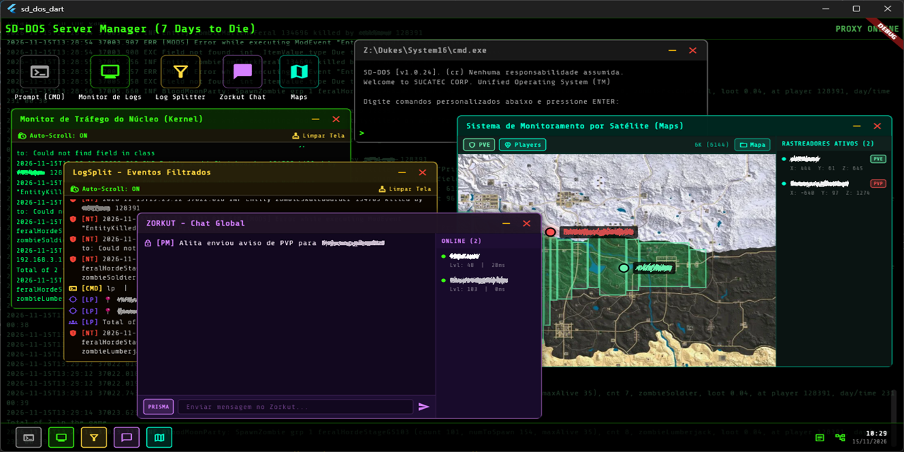

# sd_dos_dart
Lightweight retro-OS visual server manager for 7 Days to Die with automated PVP/PVE zone control, live player radar, built-in proxy generator, multi-language support, and integrated chat (Flutter + Python).



[🇧🇷 Leia em Português](README_pt-br.md)

# SD-DOS Server Manager (v1.2)

Lightweight visual manager for **7 Days to Die** dedicated servers, inspired by classic operating systems. Built to provide automated PVP/PVE border control, log monitoring, a tactical player radar, real-time localization, and zero-code network setup.

## What's New in v1.2
* **Multi-Language Support (i18n) & Live Switching:** Full localization architecture powered by structured context-aware JSON files (`assets/lang/`). Switch languages on the fly from the Windows-style system tray selector (`ENG/USA`, `POR/BRA`, `ESP/ESP`) without dropping your active WebSocket connection.
* **Automatic System Locale Detection:** Automatically detects your operating system's language on first launch (`en-US`, `pt-BR`, `es-ES`) and persists your manual preference locally.
* **Localized Proxy Script Generation:** **NetConfig** now generates `.py` bridge scripts and `.bat` launchers with terminal logs already translated into your currently selected UI language.
* **AI-Friendly Translation Schema:** Includes embedded `_meta.ai_instructions` and per-key `context` constraints so contributors or LLMs can accurately translate the entire interface into new languages without breaking UI layouts or color tags.

## Previous Highlights (v1.1)
* **NetConfig App (TCP/IP & Script Generator):** Configure Proxy IP, port, and secret token directly from the UI with local persistence (`shared_preferences`) and streamer-safe visibility toggles (`obscureText`).
* **Hardened WebSocket Connection:** Connection generation IDs, UI button debounce, and WebSocket `ping_interval` / `ping_timeout` to eliminate ghost connections, duplicate sessions, and rapid-click reconnection loops.
* **High-Performance Log Monitors:** 1,000-line circular memory buffer and `SelectionArea` rendering in **Monitor** and **LogSplit** to prevent UI freezes during long server sessions.

## Core Features
* **Multi-Language UI:** Instant switching between **English (`en-US`)**, **Portuguese (`pt-BR`)**, and **Spanish (`es-ES`)** via the taskbar tray.
* **NetConfig:** Visual network configuration, persistent credentials, and one-click localized `.py` / `.bat` proxy script export.
* **Maps:** Interactive map with zoom, configurable PVE zone overlays, and live player tracking.
* **PVP / PVE Automation:** Automatic private warnings sent to players crossing borders between safe and hostile biomes.
* **Zorkut Chat:** Global chat interface compatible with both vanilla console commands (`say`) and Prisma Core (`sayadmin`).
* **Log Splitter & Monitor:** Smart server event filtering (`[LP]`, `[CHAT]`, `[CMD]`, `[PC]`) with automatic scroll lock and memory protection.
* **Prompt (CMD):** Built-in terminal for quick Telnet administrative commands.

## Project Objective

To create a visually user-friendly environment for the secure management of game servers and file editors. Lightweight and with multiple tools. In its final version, it will run on computers, browsers, and Android phones (yes, you'll be able to use that idle processor from your old phone stored in a drawer).

## Tech Stack
* **Frontend / UI:** Flutter (Windows Desktop / Web)
* **Backend / Telnet Bridge:** Python (`websockets`)

## Execution Logic

* The Python proxy script can run directly on the game server or on another machine. It maintains low CPU overhead and isolates Telnet credentials from client interfaces.
* Multiple manager interfaces can connect simultaneously to the same WebSocket proxy without overloading the game's Telnet port.
* You can run everything on the same PC, or host the **Game Server**, **Python Proxy**, and **Manager Interfaces** on separate machines.

## Quick Setup & Configuration

You no longer need to manually edit source code files to configure your connection.

### 1. Launch the Manager
* **Windows Executable:** Download the latest release `.zip`, extract the full folder (keep `.exe`, `.dll`, and `data/` together), and run `sd_dos_dart.exe`.
* **From Source:** Run `flutter pub get` and `flutter run -d windows` (or `-d chrome`).
* On first launch, the app automatically loads your OS language (or defaults to English) and opens **NetConfig** when no saved credentials are found.

### 2. Generate the Proxy Script (`.py` & `.bat`)
Install the Python WebSocket dependency on the machine that will host the bridge:
```bash
pip install websockets
```

Inside **NetConfig**, switch to tab **2. Generate Script (.py / .bat)**:
1. **7D2D Telnet Settings:** Enter your server IP (`127.0.0.1` if local), `TelnetPort` (default `8081`), and `TelnetPassword` from `serverconfig.xml`.
2. **WebSocket Bridge Settings:** Set `WS_HOST` (`0.0.0.0` for external access or `127.0.0.1` for local), `WS_PORT` (default `8082`), and create a strong `WS_TOKEN`.
3. **Export Files:** Click **DOWNLOAD SCRIPT (.PY)** and **DOWNLOAD LAUNCHER (.BAT)** to save both files in the same folder, then double-click the `.bat` file to start the bridge.

### 3. Connect the Interface
Inside **NetConfig**, go to tab **1. Panel Connection**:
* Enter the Proxy IP, Port, and the `WS_TOKEN` you created, then click **SAVE AND CONNECT TO PROXY**.
* Credentials are stored locally on your device for automatic reconnection on future launches.

## Adding New Translations (AI & Community Guide)

All UI strings, tooltips, and generated script messages live in `assets/lang/` using a self-documented JSON format:

1. Copy `assets/lang/en-US.json` and rename it using the **IETF BCP 47** standard (e.g., `de-DE.json`, `ru-RU.json`, `fr-FR.json`).
2. Translate only the `"text"` fields (manually or via an LLM) while following `"_meta.ai_instructions"` and each key's `"context"` character-limit notes.
3. Update `"_meta"` (`language_name`, `language_code`, `tray_top`, `tray_bottom`) and register the new code in `LangService.idiomasDisponiveis` (`lib/services/lang_service.dart`).

> **Golden Rules:** Never translate JSON keys, `"context"` fields, placeholders in curly braces (`{player}`, `{count}`, `{SDTD_HOST}`), or game color tags (`[39FF14]`, `[-]`).

## Advanced Customization (Source Code)

* **PVE Zones (`retangulosPve` in `lib/main.dart`):** Adjust the `[minX, maxX, minZ, maxZ]` coordinate rectangles to match your map's safe zones (Navezgane Pine Forest is configured by default).
* **Custom Map (Optional):** Load any square map image (`.png` / `.webp`) directly from the **Maps** top toolbar by entering its file path and world size (`6144`, `8192`, `10240`, `16384`).
* **Admin Permissions Warning:** Global messages in Prisma Core mode currently send `sayadmin` with permission level `99`. Do not assign permission level `99` to regular players without reviewing your server admin configuration (`0` is highest admin, `<= 100` often grants admin commands by default). Use the **Vanilla** toggle button in Zorkut for standard `say` broadcasts if unsure.

## License
This project is released under **The Unlicense** (Public Domain). You are free to copy, modify, publish, use, or distribute this software for any purpose without attribution.

# Transparency in Development and AI

Designed, archected, and tested on real servers. Gemini and GitHub Copilot (VS Code) aided the workflow strictly as pair programming tools, not as standalone code generators. There was no automatic prompt generation or mass development—development followed a slow, deliberate, and modular approach, where each component was audited, understood, and manually tested under extreme conditions before integration.
