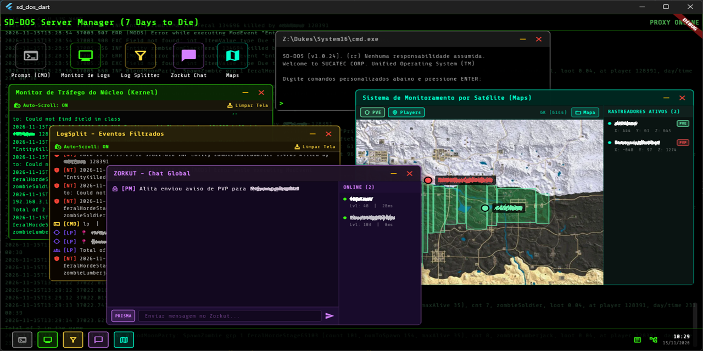

# sd_dos_dart
Gerenciador visual leve com estilo de sistema operacional retrô para servidores de 7 Days to Die, com controle automatizado de zonas PVP/PVE, radar de jogadores em tempo real, gerador de proxy integrado, suporte a múltiplos idiomas e chat integrado (Flutter + Python).



[🇺🇸 Read in English](README.md)

# SD-DOS Server Manager (v1.2)

Gerenciador visual leve para servidores dedicados de **7 Days to Die**, inspirado em sistemas operacionais clássicos. Desenvolvido para oferecer controle automatizado de fronteiras PVP/PVE, monitoramento de logs, radar tático de jogadores, localização em tempo real e configuração de rede sem precisar editar código.

## Novidades da v1.2
* **Suporte a Múltiplos Idiomas (i18n) e Troca em Tempo Real:** Arquitetura completa de localização baseada em arquivos JSON estruturados com contexto (`assets/lang/`). Alterne entre idiomas instantaneamente pelo seletor na bandeja do sistema estilo Windows (`POR/BRA`, `ENG/USA`, `ESP/ESP`) sem derrubar a conexão WebSocket ativa.
* **Detecção Automática do Idioma do Sistema:** Detecta automaticamente o idioma do seu sistema operacional na primeira inicialização (`pt-BR`, `en-US`, `es-ES`) e salva sua escolha manual localmente.
* **Geração de Scripts Proxy Localizados:** O **NetConfig** agora gera scripts ponte `.py` e inicializadores `.bat` com as mensagens de console já traduzidas para o idioma ativo na interface.
* **Esquema de Tradução Amigável para IA:** Inclui instruções embutidas em `_meta.ai_instructions` e restrições de espaço em cada campo `context` para que colaboradores ou IAs possam traduzir toda a interface para novos idiomas sem quebrar o layout ou as tags de cor.

## Destaques Anteriores (v1.1)
* **Aplicativo NetConfig (TCP/IP e Gerador de Scripts):** Configure IP do Proxy, porta e token secreto diretamente pela interface com persistência local (`shared_preferences`) e botões de ocultar dados sensíveis (`obscureText`) para streamers.
* **Conexão WebSocket Blindada:** IDs de geração de conexão, debounce nos botões e `ping_interval` / `ping_timeout` no WebSocket para eliminar conexões fantasmas, sessões duplicadas e loops de reconexão por cliques rápidos.
* **Monitores de Logs de Alta Performance:** Buffer circular de memória com limite de 1.000 linhas e renderização otimizada com `SelectionArea` no **Monitor** e no **LogSplit** para evitar travamentos em sessões longas.

## Funcionalidades Principais
* **Interface Multilíngue:** Troca instantânea entre **Português (`pt-BR`)**, **Inglês (`en-US`)** e **Espanhol (`es-ES`)** pela bandeja da barra de tarefas.
* **NetConfig:** Configuração visual de rede, credenciais persistentes e exportação de scripts `.py` / `.bat` localizados com um clique.
* **Maps:** Mapa interativo com zoom, camadas configuráveis de zonas seguras PVE e rastreamento de jogadores em tempo real.
* **Automação PVP / PVE:** Avisos privados enviados automaticamente aos jogadores ao cruzarem fronteiras entre biomas seguros e hostis.
* **Zorkut Chat:** Interface de chat global compatível tanto com comandos nativos do console (`say`) quanto com o mod Prisma Core (`sayadmin`).
* **Log Splitter e Monitor:** Filtragem inteligente de eventos do servidor (`[LP]`, `[CHAT]`, `[CMD]`, `[PC]`) com trava automática de rolagem e proteção de memória.
* **Prompt (CMD):** Terminal integrado para envio rápido de comandos administrativos via Telnet.

## Objetivo do Projeto

Criar um ambiente visualmente amigável para o gerenciamento seguro de servidores de jogos e editores de arquivos. Leve e com múltiplas ferramentas. Em sua versão final, rodará em computadores, navegadores e celulares Android (sim, você poderá aproveitar aquele processador parado do seu celular antigo guardado na gaveta).

## Stack Tecnológica
* **Frontend / Interface:** Flutter (Windows Desktop / Web)
* **Backend / Ponte Telnet:** Python (`websockets`)

## Lógica de Execução

* O script proxy em Python pode rodar diretamente na máquina do servidor do jogo ou em outro computador. Ele mantém baixo consumo de CPU e isola as credenciais Telnet das interfaces clientes.
* Múltiplas interfaces de gerenciamento podem se conectar simultaneamente ao mesmo proxy WebSocket sem sobrecarregar a porta Telnet do jogo.
* Você pode rodar tudo no mesmo PC ou hospedar o **Servidor do Jogo**, o **Proxy Python** e as **Interfaces de Gerenciamento** em máquinas separadas.

## Instalação Rápida e Configuração

Você não precisa mais editar arquivos de código-fonte manualmente para configurar sua conexão.

### 1. Iniciar o Gerenciador
* **Executável Windows:** Baixe o `.zip` da última release, extraia a pasta completa (mantenha o `.exe`, as `.dll` e a pasta `data/` juntos) e execute o `sd_dos_dart.exe`.
* **Pelo Código-Fonte:** Execute `flutter pub get` e `flutter run -d windows` (ou `-d chrome`).
* Na primeira abertura, o aplicativo carrega automaticamente o idioma do seu sistema operacional (ou inglês como padrão) e abre o **NetConfig** caso não encontre credenciais salvas.

### 2. Gerar o Script Proxy (`.py` e `.bat`)
Instale a dependência WebSocket do Python na máquina que vai hospedar a ponte:
```bash
pip install websockets
```

Dentro do **NetConfig**, acesse a aba **2. Gerar Script (.py / .bat)**:
1. **Configuração do Telnet (7 Days to Die):** Informe o IP do servidor (`127.0.0.1` se for local), `TelnetPort` (padrão `8081`) e `TelnetPassword` definidos no `serverconfig.xml`.
2. **Configuração da Ponte WebSocket:** Defina `WS_HOST` (`0.0.0.0` para acesso externo ou `127.0.0.1` apenas local), `WS_PORT` (padrão `8082`) e crie um `WS_TOKEN` forte.
3. **Exportar Arquivos:** Clique em **BAIXAR SCRIPT (.PY)** e **BAIXAR ATALHO (.BAT)** para salvar ambos na mesma pasta e dê um duplo clique no `.bat` para iniciar a ponte.

### 3. Conectar a Interface
Dentro do **NetConfig**, volte para a aba **1. Conexão do Painel**:
* Preencha o IP do Proxy, a Porta e o `WS_TOKEN` que você criou e clique em **SALVAR E CONECTAR AO PROXY**.
* As credenciais ficam salvas localmente no seu dispositivo para reconexão automática nas próximas vezes.

## Adicionando Novas Traduções (Guia para Comunidade e IA)

Todos os textos da interface, dicas (tooltips) e mensagens dos scripts gerados ficam em `assets/lang/` em um formato JSON autodocumentado:

1. Copie o arquivo `assets/lang/pt-BR.json` (ou `en-US.json`) e renomeie seguindo o padrão **IETF BCP 47** (ex: `de-DE.json`, `ru-RU.json`, `fr-FR.json`).
2. Traduza apenas os campos `"text"` (manualmente ou usando uma IA) seguindo as instruções de `"_meta.ai_instructions"` e os limites de caracteres descritos em cada campo `"context"`.
3. Atualize o bloco `"_meta"` (`language_name`, `language_code`, `tray_top`, `tray_bottom`) e registre o novo código no mapa `LangService.idiomasDisponiveis` (`lib/services/lang_service.dart`).

> **Regras de Ouro:** Nunca traduza as chaves do JSON, os campos `"context"`, variáveis entre chaves (`{player}`, `{count}`, `{SDTD_HOST}`) ou tags de cor do jogo (`[39FF14]`, `[-]`).

## Personalização Avançada (Código-Fonte)

* **Zonas PVE (`retangulosPve` em `lib/main.dart`):** Ajuste os retângulos de coordenadas `[minX, maxX, minZ, maxZ]` para corresponder às áreas seguras do seu mapa (a Floresta Pinhal de Navezgane vem configurada por padrão).
* **Mapa Customizado (Opcional):** Carregue qualquer imagem quadrada de mapa (`.png` / `.webp`) diretamente pela barra superior do aplicativo **Maps**, informando o caminho do arquivo e o tamanho do mundo (`6144`, `8192`, `10240`, `16384`).
* **Aviso sobre Permissões de Admin:** As mensagens globais no modo Prisma Core enviam atualmente o comando `sayadmin` com nível de permissão `99`. Não atribua nível de permissão `99` a jogadores comuns sem revisar sua configuração de administradores do servidor (`0` é o nível máximo de admin e `<= 100` costuma liberar comandos administrativos por padrão). Na dúvida, use o botão alternador **Vanilla** no Zorkut para enviar mensagens padrão via `say`.

## Licença
Este projeto é disponibilizado sob **The Unlicense** (Domínio Público). Você é livre para copiar, modificar, publicar, usar ou distribuir este software para qualquer finalidade, sem necessidade de atribuição.

# Transparência no Desenvolvimento e IA

Projetado, arquitetado e testado em servidores reais. Gemini e GitHub Copilot (VS Code) auxiliaram no fluxo estritamente como ferramentas de *pair programming*, e não como geradores autônomos de código. Não houve geração automática de prompts nem desenvolvimento em massa — o desenvolvimento seguiu uma abordagem lenta, deliberada e modular, onde cada componente foi auditado, compreendido e testado manualmente em condições extremas antes da integração.
